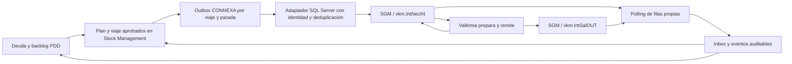

# PDD — Integración de viajes CONNEXA con SGM y Valkimia

**Estado:** especificación funcional y diseño técnico propuesto, pendiente de validación conjunta con SGM/Valkimia.  
**Fecha:** 2026-11-19.  
**Ámbito:** CD 41; TEST primero en `[data-sync].[vkm]`; después interfaz productiva que consume Valkimia. No autoriza escrituras en producción por sí mismo.

## 1. Decisión de arquitectura

CONNEXA conserva la **necesidad, el plan, el viaje, sus líneas y el saldo pendiente**. Publica hacia SGM/Valkimia exclusivamente las líneas de un viaje aprobado. Valkimia prepara y remite; CONNEXA lee las respuestas de sus propias líneas y concilia preparación y despacho con el viaje original. El estado de una fila externa nunca sustituye el historial interno de CONNEXA.

El contrato operativo existente ya modela `pdd_dispatch_plan`, `pdd_dispatch_trip`, `pdd_dispatch_trip_stop`, `pdd_dispatch_trip_line`, `pdd_dispatch_line_allocation`, `pdd_valkimia_import` y `pdd_valkimia_import_line` en `stock_management` (migración `backend/contracts/sql/planning_migration_v2_7.sql`). El contrato HTTP `backend/contracts/pdd-planning-openapi-v1.yaml` incluye `publishDispatchTrip`, listado, detalle y consulta inmediata de importaciones. Su runtime previsto es el backend **Java Stock Management**; el backend Python/Prefect calcula y publica deuda/backlog. La presente especificación concreta el **adaptador legacy SQL Server** para esos puertos y las reglas de conciliación aún faltantes; no presupone que ya exista código funcional para publicar o consultar la interfaz.

`[data-sync].[vkm]` se usa para pruebas de contrato. Antes de producción se debe identificar el servidor/base/esquema reales, el mecanismo autorizado de escritura (tabla o procedimiento), el consumidor de SGM y la frontera de red. La relación de confianza entre servidores indica conectividad posible, no garantiza semántica, permisos ni transacciones distribuidas. TEST y PROD deben tener credenciales, cursores, colas y claves de idempotencia separados.

## 2. Hechos confirmados en la planilla y límites del contrato

Fuente: `VKM - Tablas Diarco interfaz.xlsx`, hojas `INTNECIN` (filas 3–32) e `INTSALOUT` (filas 3–42), entregada por el usuario. La planilla describe columnas; no es un DDL ni demuestra `NULL`, `DEFAULT`, `IDENTITY`, índices, triggers, FK, reglas de copia entre tablas o permisos reales. Se debe contrastar con `sys.columns`, `sys.indexes`, `sys.triggers`, procedimientos y pruebas de punta a punta.

| Interfaz | Papel observado | Identidad y estado | Cantidades y referencia |
| --- | --- | --- | --- |
| `IntNecIN` | Solicitud de necesidad por artículo y entidad/sucursal | `INIId` autonumerado; `INIEst`: `ACO` grabado por ERP, `PRE` tomado por WMS, `ETR` anulado en WMS, `REM` remitido en WMS | `INICnt1` solicitado; `INICnt1Pre` preparado; `INICnt1Rem` remitado; `INIObs` de 100 caracteres; `INIIdSincro` identificado como ID interno SGM |
| `IntSalOUT` | Preparación/salida documentada por remito e ítem | `ISOId` autonumerado; `ISOEst` descrito como “1: Pendiente”; `ISODocId` y `ISODocItem`; `ISODocIdR` como número de armado VKM | `ISOCnt1` unidades; `ISOObs` de 100 caracteres; `ISOTipDoc`, `ISODocLetra`, `ISOPreNro` y otros datos documentales |

La planilla **no muestra `INIId` en `IntSalOUT`** ni un identificador de viaje en ninguna de las tablas. Por tanto, no está demostrada una unión inequívoca entre salida y necesidad. El usuario confirmó que se puede reservar `INIObs` para una referencia CONNEXA; falta comprobar si SGM/Valkimia la conserva y la reproduce en `ISOObs` o proporciona otra relación formal. `INIIdSincro`, `ISODocIdR`, `ISODocIteR` y `ISOIteNum` no se usarán como correlación hasta que SGM explique y pruebe su semántica.

## 3. Unidad de publicación y propiedad de datos

**Unidad lógica:** una línea publicada por `dispatch_trip_line_uuid`, dentro de un `dispatch_trip_uuid` aprobado y una parada/sucursal. **Unidad física propuesta:** una fila `IntNecIN` por línea de viaje. Si SGM exige consolidación por artículo/sucursal, el adaptador debe conservar una tabla de desglose exacto entre cada `INIId` y sus líneas CONNEXA, y acordar cómo distribuir cantidades preparadas/remitadas entre ellas. No se consolidan líneas de viajes distintos por conveniencia.

Antes de generar el outbox, CONNEXA congela la versión del viaje, la foto del backlog, las imputaciones DECAS, artículo, sucursal, unidad, cantidad, fecha y autor. Valida viaje `APPROVED`, par dentro del scope vigente, logística y conversión de unidades, fecha de entrega válida, cantidad positiva, capacidad y saldo disponible. Una línea no aprobada, fuera del viaje o con cambio de versión no se envía. La selección y la cantidad del viaje pertenecen a CONNEXA; `INICnt1` no se recalcula desde la deuda diaria al momento del envío.

| Campo / dato | Dueño | Regla propuesta |
| --- | --- | --- |
| `dispatch_trip_uuid`, `dispatch_trip_line_uuid`, plan, stop, asignación DECAS | CONNEXA | Inmutables desde la publicación; correcciones posteriores mediante revisión/compensación auditada |
| `INIId`, `INIIdSincro` | SGM/interfaz | No asignar ni modificar desde CONNEXA salvo mecanismo oficial; capturar el ID devuelto por el insert/ack |
| `INIObs` | CONNEXA en la fila que crea | Reservar token de correlación estable; evitar texto libre que lo trunque |
| `INIEst`, `INIFecEst`, `INICnt1Pre`, `INICnt1Rem` | SGM/Valkimia | Sólo lectura para CONNEXA tras publicación; registrar cada cambio |
| `ISO*` | SGM/Valkimia | Sólo lectura para CONNEXA; nunca insertar remitos desde el adaptador PDD |
| Estado y saldos PDD | CONNEXA | Proyección propia a partir de eventos externos; conservar código/valor crudo |

### Mapeo saliente mínimo a `IntNecIN`

| Columna | Origen/regla | Validación pendiente |
| --- | --- | --- |
| `INIFecEnt` | Fecha de entrega comprometida para la parada | Precisar zona horaria y regla de corte; no equiparar automáticamente con salida del camión |
| `INIDepId` | CD origen `41` | Confirmar que la instancia productiva usa el mismo código |
| `INIEntId` | Sucursal/entidad del stop | Confirmar tabla de equivalencias SGM, no asumir igualdad numérica |
| `INIArtId` | Código de artículo SGM de la línea | Confirmar existencia y unidad de venta/preparación |
| `INIUxB` | Unidades por bulto del snapshot logístico | Definir vigencia y tratamiento de cambios de empaque |
| `INICnt1` | Cantidad congelada de la línea, en unidades de la interfaz | `money` de SQL Server: precisión de 4 decimales; rechazar o convertir explícitamente `KG`/fracciones incompatibles |
| `INIObs` | Token propuesto `CNX|T:<uuid-viaje>|L:<uuid-línea>` (81 caracteres) | Confirmar que SGM acepta y conserva los 100 caracteres sin reescritura |
| `INIEst`, `INIFecReg`, `INIUsuReg`, `EmpId`, `INIMRecibido` | Valores exigidos por contrato SGM (planilla sugiere `ACO`, empresa `1`, recibido `S`) | Confirmar cuáles asigna la interfaz, cuáles inserta el adaptador y usuario técnico autorizado |
| `INIArtC`, `INICnt2`, `INIMotPed`, `INICnt2Rem`, `INICnt2Pre`, `INILinPrio` | No derivar ni rellenar por suposición | Definir obligatoriedad/default con SGM |
| `INIId`, `INIIdSincro`, `INIFecEst`, `INICnt1Pre`, `INICnt1Rem` | Generados/actualizados por SGM/WMS | No establecerlos en el insert CONNEXA sin confirmación del contrato |

El token incluye viaje y línea y cabe en `INIObs`. Para una republicación de la **misma** línea se reutiliza exactamente el token. Una modificación material después de que SGM aceptó la fila no sobrescribe cantidades en sitio: se documenta revisión, se gestiona cancelación si todavía está permitida y, cuando corresponda, se publica una nueva identidad de línea/revisión. Debe acordarse si `INIObs` admite ese formato y si SGM lo mantiene visible en su flujo.

## 4. Publicación y confirmación sin duplicados

1. `publishDispatchTrip` registra, en una transacción PostgreSQL, el snapshot aprobado, `pdd_valkimia_import` y sus líneas, una clave idempotente por `ambiente + trip_uuid + trip_line_uuid + revisión`, hash del payload y un outbox `PENDING`. La respuesta HTTP `202` significa **encolado**, no aceptado por SGM. Reservar el saldo planificado en PDD sin reducir la deuda original.
2. Un único adaptador por ambiente consume el outbox. En SQL Server usa una operación transaccional aprobada por SGM que verifica la clave externa y crea la fila una sola vez, recuperando `INIId` (por ejemplo `OUTPUT INSERTED.INIId` si se permite `INSERT` directo). Registrar `INIId` y hash de la carga en una tabla de correlación/registro con clave única dentro de **la misma transacción SQL Server**. La tabla de correlación puede residir en `[data-sync].[vkm]` durante TEST; definir ubicación equivalente en PROD.
3. Si el `COMMIT` remoto ocurrió pero se perdió la respuesta, el reintento consulta el registro de correlación y la fila por clave. Mismo token + mismo hash devuelve el mismo `INIId`; mismo token + distinto hash abre conflicto, nunca crea otra necesidad. Un `SELECT` previo sin restricción/serialización no basta para garantizar idempotencia. Si SGM no permite tabla auxiliar, índice o procedimiento equivalente, se necesita otro mecanismo transaccional comprobado antes de activar la escritura automática.
4. La confirmación separa `PUBLISH_PENDING`, `PUBLISHED/ACKNOWLEDGED` y `FAILED/UNKNOWN`. Un timeout deja estado `UNKNOWN` hasta investigar por clave; no se reenvía a ciegas. Guardar hora, usuario, versión, payload/hash, `INIId`, resultado SQL y cada intento.
5. Aislar fallos por línea/viaje y alertar. Un rechazo de artículo no debe impedir que la deuda diaria de toda la cadena se calcule. Sí debe impedir que ese viaje figure como completamente publicado.

No se usan `DELETE` de `IntNecIN` ni `IntSalOUT` para “sincronizar”. Para cancelar una línea, CONNEXA solicita una transición **sólo si SGM autoriza su protocolo**, registra motivo, actor, estado previo y respuesta. Si ya está `PRE` o `REM`, la corrección se hace por procedimiento operativo de SGM/Valkimia; CONNEXA no fuerza `ETR`. Un faltante, rechazo o desaparición externa conserva el saldo y genera una incidencia explícita.

**Registro mínimo del adaptador (propuesta):** `(environment, adapter_code, trip_uuid, trip_line_uuid, revision, external_token, payload_hash, ini_id, published_at, last_seen_at, publication_state, last_error)`, con `UNIQUE(environment, adapter_code, external_token)` y `UNIQUE(environment, adapter_code, ini_id)` cuando `ini_id` no sea nulo. El registro remoto usado para deduplicar debe compartir transacción con el insert de `IntNecIN`; CONNEXA replica el resultado en su base operativa y conserva el outbox hasta confirmarlo. El inbox de lectura guarda `(source_table, external_id, row_hash, observed_at, raw_payload, processing_state)` con unicidad por ID y hash, de forma que una observación repetida no produce un segundo efecto. Definir capacidad y política de retención antes de implementarlo.

## 5. Consulta y conciliación de la preparación y salida

**Ámbito de lectura:** usar exclusivamente los `INIId` registrados para publicaciones CONNEXA del ambiente y token válido. No consultar ni mutar solicitudes de otros emisores para actualizar el estado PDD. Un escaneo amplio sólo puede servir a monitoreo de anomalías y debe ser de solo lectura.

El poller captura por fila propia `INIEst`, `INIFecEst`, `INICnt1Pre`, `INICnt1Rem`, `INICnt1`, fecha de actualización disponible y hash completo. Como la planilla no garantiza `rowversion` ni marca temporal en todos los cambios, el cursor por fecha **no es suficiente**: recorrer periódicamente todas las filas no terminales propias, comparar hash y hacer una conciliación completa diaria/por viaje hasta el cierre. Guardar evidencia cruda, hora de lectura, versión de mapeo y evento normalizado. Una fila que antes se leyó y ahora no existe se marca `MISSING_EXTERNAL_ROW`, con alarma y sin liberar automáticamente su saldo.

| Código / señal | Lectura inicial propuesta | Regla de cantidad |
| --- | --- | --- |
| `ACO` | Registrada, pendiente de toma por WMS | `INICnt1` solicitado; no implica preparación |
| `PRE` | Tomada por WMS / en preparación | `INICnt1Pre` preparado observado; validar cuándo se actualiza |
| `ETR` | Anulada en WMS | Confirmar si es anulación total o parcial; no inferir remanente desde el código solo |
| `REM` | Remitida | `INICnt1Rem` remitido observado; validar correspondencia con `IntSalOUT` |
| Desconocido | `UNKNOWN` | Conservar código crudo, detener sólo la conciliación de la línea afectada y alertar |

Para `IntSalOUT`, la clave natural candidata es documento + ítem + empresa + depósito, **por validar** con SGM; `ISOId` identifica fila externa, pero pueden existir correcciones o duplicados funcionales. Leer únicamente filas que puedan relacionarse de manera demostrable con `INIId`/token de CONNEXA. Si `ISOObs` contiene el token y la prueba demuestra que es estable, usarlo con validación adicional de sucursal, artículo, depósito y cantidades. Si no se copia, SGM debe entregar una relación oficial `INIId` ↔ `ISOId`/remito/ítem o un procedimiento de consulta. Un match por artículo+sucursal+fecha, por proximidad horaria o sólo por remito **no acredita** un despacho y queda en cuarentena `UNMATCHED_DISPATCH`.

`IntSalOUT` puede contener varias filas para una necesidad, varios remitos o correcciones. La conciliación guarda cada `ISOId` y su versión/hash; computa la cantidad **neta** de salidas válidas según semántica de `ISOEst` y documentos correctivos confirmada por SGM. Nunca suma otra vez el mismo `ISOId` tras un reintento. El documento de remito (`ISOTipDoc`, `ISODocId`, `ISODocItem`, `ISODocLetra`, `ISOPreNro`) se muestra como evidencia de despacho; `ISODocIdR` se conserva como referencia al armado, no se reinterpreta como `INIId`.

**Invariantes por línea**, salvo corrección externa documentada y aprobada: `0 ≤ remitido ≤ preparado ≤ solicitado`; la suma de salidas válidas de `IntSalOUT` debe coincidir con `INICnt1Rem` dentro de la tolerancia de la unidad. En caso de discrepancia o cantidades retrocedidas, conservar ambos valores, abrir incidencia y no marcar la línea como finalizada. No convertir `PRE` en “despachado”, ni `REM` en “entregado en sucursal”: la planilla no describe una confirmación de recepción. `DELIVERED` necesita otra fuente/contrato.

## 6. Saldo, backlog y continuidad del cálculo diario

Separar tres conceptos por línea: **necesidad abierta** PDD, **cantidad comprometida en viaje/publicada** y **cantidad remitida verificada**. La publicación reserva el saldo planificable, pero no lo satisface. La preparación tampoco satisface deuda. La cantidad efectivamente remitida se imputa una sola vez a la asignación DECAS congelada de esa línea. El remanente no remitido vuelve a quedar disponible sólo tras un estado terminal confiable o una liberación operativa auditada; no se libera al faltar una fila externa ni por timeout. Una nueva foto diaria debe usar estas proyecciones sin recontar lo ya remitido o lo aún comprometido.

El guard actual de `backend/pdd_backend/jobs/backlog.py` detiene la publicación si existe cualquier `pdd_valkimia_import` con `PENDING`, `ACCEPTED` o `PARTIAL` (mensaje “Hay importaciones Valkimia activas…”). Es una protección correcta mientras no exista conciliación, pero debe reemplazarse **después** de implementar proyecciones y pruebas de invariantes. La meta es continuar el cálculo diario aun con viajes activos, descontando del saldo planificable sus compromisos y mostrando incidencias por línea. Una pérdida de frescura global o inconsistencia de doble asignación sí bloquea la publicación de nuevos viajes; no se resuelve borrando filas.

## 7. Observabilidad y operación

Vista por viaje y parada: número de líneas previstas, publicadas y aceptadas; unidades solicitadas, preparadas y remitidas; remitos; diferencias; último sondeo; estado de interfaz; incidencias con artículo/sucursal/`INIId`/`ISOId`; botón de reconsulta y acción de resolución. Vista de excepciones filtrable por viaje, sucursal, artículo, fecha y código (`PUBLISH_UNKNOWN`, `EXTERNAL_ROW_MISSING`, `UNMATCHED_DISPATCH`, `QUANTITY_MISMATCH`, `UNMAPPED_STATUS`, `STALE_POLL`, `DUPLICATE_EXTERNAL_KEY`). Exportable para auditoría.

Métricas mínimas: edad del outbox, tiempo desde publicación hasta `INIId`, antigüedad del último sondeo por viaje activo, diferencias de cantidades, filas externas faltantes, salidas sin correlación, duplicados evitados y viajes atascados. Umbrales y responsables de alerta deben acordarse con operaciones. Se conservan los eventos crudos y la relación de IDs aun después de que termine un viaje; definir retención con auditoría y requisitos legales, sin purgas silenciosas.

El worker de integración opera independiente de `PDD_OPERATIONAL_DAILY_MASTER`; el cálculo diario consume una proyección consistente y muestra su frescura. El precheck valida conexión, mapeos y lag antes de la ventana de viajes, pero no crea necesidades. No programar un reenvío ciego en el mismo horario que la generación de planes.

## 8. Pruebas y criterios de aceptación

**Etapa 1 — contrato en `[data-sync].[vkm]`.** Obtener DDL y procedimientos reales, insertar una línea de prueba con token, recuperar `INIId`, verificar que el consumidor la toma, observar cada transición, comprobar si `ISOObs` conserva el token o cuál es la relación oficial, reproducir remito parcial y múltiple, y documentar qué componente fija cada columna. Si las tablas son copias sin consumidor WMS, usar simulador controlado y repetir la prueba end-to-end en homologación antes de PROD.

**Etapa 2 — adaptador en TEST.** Probar al menos: dos viajes con el mismo artículo/sucursal, dos líneas del mismo viaje, reintento tras respuesta perdida, hash distinto con misma clave, parcial con remanente, anulación `ETR`, remito dividido, doble lectura de `ISOId`, corrección de remito, estado desconocido, desaparición de fila, caída de SQL Server y recuperación. Ningún caso duplica necesidad, atribuye una salida a otro viaje, pierde el remanente o detiene la deuda diaria de todos los pares por una sola línea.

**Etapa 3 — PROD.** Activar lectura/conciliación en sombra, comparar con operación manual por viajes reales, reconciliar totales de `IntNecIN`/`IntSalOUT` con CONNEXA, habilitar escritura para un grupo acotado con exclusión de doble emisión SGM, vigilar y ampliar. Mantener interruptor para pausar **nuevas publicaciones** sin perder sondeo ni historial; retroceso mediante ese interruptor y resolución de filas existentes, nunca mediante `DELETE` externo.

**Aceptación final:** 100 % de líneas publicadas tienen token único y `INIId`; 100 % de despachos aplicados tienen vínculo probado con la línea y documento; los reintentos no duplican; la suma preparada/remitida concilia o expone excepción; la deuda y el backlog conservan remanentes y el cálculo diario sigue operativo con viajes activos; un operador puede explicar cada diferencia desde la vista de viaje hasta la fila externa.

## 9. Decisiones que SGM/Valkimia debe confirmar antes de implementar escritura productiva

1. DDL real y mecanismo de inserción aprobado en PROD: obligatoriedad/defaults, triggers, `IDENTITY`, índices, permisos, usuario registrador, y si el escritor debe llamar un procedimiento de SGM en lugar de hacer `INSERT` directo.
2. Si `INIObs` se conserva íntegro y si la correlación viaja a `ISOObs`; de no hacerlo, relación oficial entre `INIId` y `ISOId` con cardinalidad y ejemplos reales. **Sin esta respuesta no hay conciliación fiable de remitos.**
3. Significado exacto de `INIIdSincro`, `INIMRecibido`, `INILinPrio`, `INICnt2*`, `ISOEst`, `ISOMEnviado` y documentos relacionados. Quién cambia cada estado y en qué transacción.
4. Semántica de `INICnt1Pre`, `INICnt1Rem` e `ISOCnt1`: acumulado o delta, unidad, parciales, correcciones, devoluciones y tolerancias. Confirmación de que `ISOEst=1` representa una fila aún pendiente y qué indica su cierre.
5. Política de cancelación de `ACO`/`PRE`/`REM`, tratamiento de stock insuficiente, filas eliminadas por WMS y evidencia que permite liberar saldo. No asumir que `ETR` es una orden que CONNEXA puede escribir.
6. Equivalencia de sucursal y artículo entre PDD y SGM, fechas/zona horaria, valor del CD/empresa y proceso que impide doble publicación desde SGM y CONNEXA.
7. Identidad del sistema que confirma entrega en sucursal. `IntSalOUT` acredita salida/remito sólo cuando su semántica esté validada.

## 10. Entregables para el equipo CONNEXA

- Implementar el puerto `publishDispatchTrip` y el adaptador SQL Server con registro transaccional de correlación, outbox, idempotencia y reintentos seguros; actualizar el OpenAPI con estado de **encolado vs. aceptado** y códigos de conflicto.
- Implementar poller/inbox, mapeo versionado de estados, conciliación `IntNecIN`/`IntSalOUT`, excepciones y saldos por `dispatch_trip_line_uuid`. Diseñar las migraciones de tablas auxiliares sin alterar las interfaces legacy hasta aprobación de SGM.
- Implementar consultas y UI de seguimiento por viaje/stop/línea, remitos y excepciones, y herramientas de reconsulta/resolución auditada.
- Reemplazar el guard global de importaciones activas en el backlog sólo al completar y validar la conciliación y las reglas de reservas/saldos.
- Entregar matriz de mapeo firmada por SGM/Valkimia, pruebas de integración en TEST, evidencia de ejecución parcial y plan de habilitación gradual en PROD.

**Fuentes internas revisadas:** `backend/contracts/README.md`, `backend/contracts/pdd-planning-openapi-v1.yaml`, `backend/contracts/sql/planning_migration_v2_7.sql`, `backend/pdd_backend/jobs/backlog.py`, `documentacion/parametros_stock/04_diccionario_catalogo.md` y la planilla adjunta. Los ejemplos JSON y documentos de `Contexto`/`Antecedentes` son propuestas históricas; esta especificación responde a la decisión actual de publicar únicamente viajes planificados por CONNEXA.
