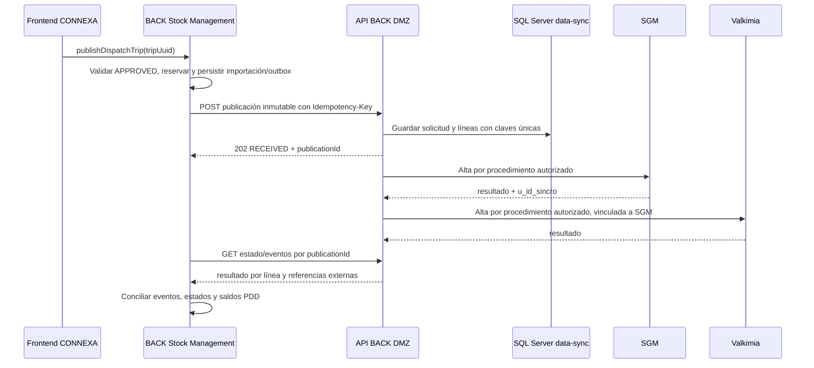

# PDD — Especificación funcional para BACK: API puente CONNEXA → SGM → Valkimia

**Fecha:** 2026-11-24  
**Versión:** 1.0 para estimación y comienzo del desarrollo  
**Estado:** propuesta funcional; contratos físicos y comportamiento de los SP desplegados pendientes de validación con SGM/Valkimia  
**Destinatario:** equipo BACK de CONNEXA  
**Modalidad:** servicio API en la DMZ con persistencia y procesamiento propios. **La publicación de transferencias no se implementa como flujo Prefect.**

## 1. Objetivo y resultado esperado

Permitir que CONNEXA publique temporalmente los viajes aprobados de PDD mediante el mecanismo legacy que da de alta transferencias en SGM y Valkimia. Desde el momento del corte, CONNEXA será el único origen de **nuevas** transferencias para el alcance migrado del CD 41. SGM seguirá ejecutando el resto de su operatoria sobre transferencias nuevas recibidas de CONNEXA y sobre las que ya existían.

El servicio debe recibir cada línea del viaje con identidad estable y cantidad congelada, crear una sola transferencia por línea mediante la secuencia aprobada de procedimientos, informar el resultado exacto de cada etapa y permitir consultar los cambios posteriores de preparación y remito. Una aceptación HTTP o una fila en staging **no equivale** a que SGM/Valkimia haya creado o preparado la transferencia.

Esta API es un **puente transitorio** detrás del contrato de publicación de Stock Management. El frontend continúa llamando a `POST /connexa/api/v1/pdd/dispatch-trips/{tripUuid}/publish`; no llama a la DMZ. Cuando exista el adaptador definitivo de Valkimia, el dominio de planes, viajes e importaciones PDD conservará sus identidades y reglas.

## 2. Contexto y límites de responsabilidad



| Responsable | Función |
| --- | --- |
| BACK Stock Management | Aprobar/publicar viaje, congelar payload, reservar saldo, mantener `pdd_valkimia_import` y líneas, outbox, proyecciones y API pública existente. Valida estado `APPROVED` antes de llamar a DMZ. |
| API BACK DMZ | Autenticar a Stock Management, aceptar y conservar la solicitud, validar formato y alcance, deduplicar, operar staging/SP para SGM y VK, exponer estado y eventos por línea, auditar intentos y conciliar respuestas externas. |
| SQL Server `data-sync` | Persistencia local duradera del puente, staging y acceso a los procedimientos remotos. La presencia de servicios en este servidor y su visibilidad a SGM/VK son datos aportados para el diseño; BACK/Infra define despliegue y permisos concretos en ese entorno. |
| SGM | Alta operativa y funciones posteriores: stock, gestión, preparación/seguimiento, remitos y correcciones según sus reglas. Confirma el procedimiento permitido y el modo de impedir otras altas nuevas. |
| Valkimia | Recepción y ejecución de la transferencia mediante el procedimiento/interfaz legacy confirmado en TEST. |

La API DMZ **no consulta directamente tablas PostgreSQL PDD** como fuente de publicación: recibe desde Stock Management el payload aprobado. Así no depende de una conectividad DMZ → PostgreSQL aún no verificada. Stock Management sondea la API DMZ; una devolución por callback es opcional y requiere otro contrato.

## 3. Alcance funcional

### Incluido

1. Recepción de publicaciones de viaje aprobado, por viaje y parada, con una o varias líneas.
2. Validación de IDs, CD/sucursal/artículo, fecha, cantidad/unidad/factor, versión, duplicados y consistencia de importación/viaje/parada.
3. Persistencia local duradera e idempotencia antes de responder `202`.
4. Alta secuencial SGM → VK por línea, con registro de `u_id_sincro` y respuesta cruda de cada procedimiento.
5. Consulta de estado y eventos por publicación/línea; reconsulta controlada de estado externo y gestión de resultados ambiguos.
6. Conciliación de preparación y remito **cuando SGM confirme la fuente y una relación inequívoca con la línea**. Si la correlación no existe, se expone incidencia sin imputar despacho.
7. Pausa de nuevas altas del puente, manteniendo consultas y seguimiento de publicaciones existentes.

### Fuera del servicio DMZ

Planificar/cubicar viajes, decidir cantidades, rehacer asignaciones DECAS, calcular backlog diario, modificar directamente estados PDD en PostgreSQL y habilitar o deshabilitar pantallas de SGM. Estas acciones tienen sus propios responsables. La API no debe crear transferencias a partir de consultas de stock ni del antiguo estado `PRECARGA_CONNEXA`.

## 4. Reglas de negocio obligatorias

| ID | Regla |
| --- | --- |
| RF-01 | Solo se aceptan publicaciones del CD 41 y del ambiente autorizado. El emisor es exclusivamente Stock Management con credencial técnica; no hay endpoint de publicación para el frontend ni usuarios SGM. |
| RF-02 | Cada línea tiene `valkimiaImportLineUuid` único y referencia a `dispatchTripLineUuid`, `dispatchTripUuid` y `valkimiaImportUuid`. Los `bigint` internos PDD no forman parte de la API. |
| RF-03 | El payload recibido se guarda inmutable. Una repetición con la misma clave y mismo hash devuelve el mismo `publicationId` y estado; misma clave con distinto hash devuelve `409 IDEMPOTENCY_CONFLICT`. |
| RF-04 | La cantidad alta en SGM/VK debe ser exactamente la aprobada tras conversión explícita y reversible de unidad. El puente no ejecuta la asignación FIFO ni cambia `plannedQuantity`/`importedQuantity` por stock disponible. |
| RF-05 | La etapa VK solo puede iniciar después de confirmar la etapa SGM y obtener un `u_id_sincro` válido. `u_id_sincro` no se equipara automáticamente con `INIId` ni con un remito. |
| RF-06 | Un timeout, desconexión o error local después de invocar una alta remota queda `UNKNOWN` hasta consultar evidencia remota por clave. No se reintenta a ciegas, aunque el staging diga `ERROR`. |
| RF-07 | El éxito del SP SGM, el éxito del SP VK, la toma por WMS, la preparación, el despacho y la entrega son hechos separados. Se informan con eventos y tiempos propios. |
| RF-08 | Ningún evento externo actualiza una línea PDD distinta de la identidad registrada. Un match por artículo+sucursal+fecha no basta. |
| RF-09 | El servicio no borra filas externas para corregir o cancelar. Una corrección requiere mecanismo SGM/VK aprobado y deja auditoría. |
| RF-10 | La pausa de publicación bloquea nuevas solicitudes o nuevas altas según configuración de corte, pero no detiene consultas, conciliación ni seguimiento de solicitudes ya aceptadas. |

## 5. Contrato HTTP interno propuesto

Base lógica: `/internal/pdd/v1/transfer-publications`. BACK podrá ajustar la ruta a su estándar, manteniendo semántica, campos e idempotencia. Todos los endpoints se restringen a la red y credenciales de servicio. Fechas ISO 8601 con offset; cantidades decimales en **cadenas** para conservar precisión.

| Operación | Resultado funcional |
| --- | --- |
| `POST /internal/pdd/v1/transfer-publications` | Recibe un viaje/importación y sus líneas; persiste solicitud y devuelve `202` al quedar en cola local, sin esperar a SGM/VK. |
| `GET /internal/pdd/v1/transfer-publications/{publicationId}` | Devuelve estado global, estado por línea y por etapa, IDs externos, incidencias y hora de última observación. |
| `GET /internal/pdd/v1/transfer-publications/{publicationId}/events?cursor=...` | Devuelve eventos inmutables y paginados para que Stock Management los aplique una sola vez. Cursor opaco y estable por ambiente. |
| `POST /internal/pdd/v1/transfer-publications/{publicationId}/refresh` | Solicita reconsulta de SGM/VK para líneas propias; devuelve `202`, no fuerza una nueva alta. |
| `GET /internal/pdd/v1/health/ready` | Informa disponibilidad de la API y de `data-sync`; la caída de SGM/VK se informa como degradación de integración, no como publicación exitosa. |

### 5.1 Solicitud de publicación

Cabeceras: `Authorization` de servicio, `Idempotency-Key` obligatoria, `X-Correlation-Id` y `Content-Type: application/json`. El hash canónico se calcula también en DMZ y se compara en cada reintento.

```json
{
  "environment": "TEST",
  "valkimiaImportUuid": "11111111-1111-4111-8111-111111111111",
  "dispatchTripUuid": "22222222-2222-4222-8222-222222222222",
  "dispatchTripStopUuid": "33333333-3333-4333-8333-333333333333",
  "tripRevision": 1,
  "originCd": 41,
  "destinationStoreCode": 12,
  "requestedAt": "2026-11-24T10:00:00-03:00",
  "requestedBy": "usuario.connexa",
  "plannedDeliveryAt": "2026-11-25T08:00:00-03:00",
  "lines": [
    {
      "valkimiaImportLineUuid": "44444444-4444-4444-8444-444444444444",
      "dispatchTripLineUuid": "55555555-5555-4555-8555-555555555555",
      "backlogLineUuid": "66666666-6666-4666-8666-666666666666",
      "codigoArticulo": 62047,
      "sucursal": 12,
      "uom": "UNIT",
      "requestedQuantity": "48.000000",
      "unitsPerPackage": "6.000000"
    }
  ]
}
```

`requestedQuantity` representa la cantidad congelada que Stock Management decidió publicar para esa línea. Antes de implementar el mapeo, SGM debe confirmar si `q_bultos` espera bultos y cómo convertir `UNIT` a esa unidad; el ejemplo **no prescribe** una conversión. El servicio rechaza cantidades/factores no representables. La versión de viaje es informativa para trazabilidad y control de duplicados; una revisión posterior a una alta remota requiere nueva identidad o procedimiento de compensación acordado.

### 5.2 Respuesta al registro y consulta

```json
{
  "publicationId": "77777777-7777-4777-8777-777777777777",
  "status": "QUEUED",
  "acceptedAt": "2026-11-24T10:00:01-03:00",
  "correlationId": "88888888-8888-4888-8888-888888888888",
  "links": {"self": "/internal/pdd/v1/transfer-publications/77777777-7777-4777-8777-777777777777"}
}
```

`GET` debe incluir para cada `valkimiaImportLineUuid`: `publicationStage`, `sgmStage`, `vkStage`, `uIdSincro` si existe, referencia VK si existe, `externalStatusRaw`, cantidades observadas y validadas, `lastObservedAt`, `lastErrorCode` y `lastErrorMessage`. El detalle externo solo se informa cuando se puede asociar con certeza a la línea. Cada evento lleva `eventId`, `publicationId`, `valkimiaImportLineUuid`, `type`, `occurredAt`, `observedAt`, `source`, `rawCode`, cantidades y referencias disponibles. Stock Management deduplica por `eventId`.

### 5.3 Respuestas de error

Errores en `application/problem+json` con `code`, `detail`, `correlationId` y, si aplica, `lineUuid`:

| HTTP | Código | Significado |
| ---: | --- | --- |
| 400 | `INVALID_REQUEST` | JSON, campos o formato inválido. |
| 401/403 | `UNAUTHORIZED` / `FORBIDDEN` | Emisor no autenticado o sin permiso para este ambiente. |
| 404 | `PUBLICATION_NOT_FOUND` | Identidad no registrada en ese ambiente. |
| 409 | `IDEMPOTENCY_CONFLICT` | Misma clave/UUID con payload distinto. |
| 409 | `PUBLICATION_PAUSED` | Altas nuevas pausadas por corte operativo. |
| 422 | `INVALID_QUANTITY_OR_UNIT` | Cantidad, factor, `KG` o precisión no representable. |
| 422 | `INCONSISTENT_TRIP` | Línea, parada, sucursal o importación inconsistente. |
| 503 | `PERSISTENCE_UNAVAILABLE` | No se pudo persistir en `data-sync`; no se acepta la solicitud. |

Las fallas posteriores de SGM/VK se consultan como **estado de la publicación y eventos**, no como un error retroactivo de la respuesta `202`.

## 6. Ciclo de vida por línea

| Estado de publicación | Evidencia requerida | Próxima acción |
| --- | --- | --- |
| `QUEUED` | Solicitud y línea guardadas en DMZ | Tomar línea para alta SGM. |
| `SGM_IN_PROGRESS` | Intento SGM registrado | Esperar resultado; al perder respuesta, pasar a `UNKNOWN`. |
| `SGM_CREATED` | Alta SGM confirmada y `u_id_sincro` válido | Iniciar etapa VK. |
| `VK_IN_PROGRESS` | Intento VK registrado | Esperar resultado; al perder respuesta, pasar a `UNKNOWN`. |
| `VK_CREATED` | Alta VK confirmada | Continuar seguimiento de ejecución WMS; no marcar despacho. |
| `REJECTED` | Error definitivo con evidencia de ausencia de alta remota | Informar rechazo por línea; conservar reserva hasta resolución PDD. |
| `UNKNOWN` | Resultado ambiguo, ausencia de vínculo o estado externo no mapeado | Reconsultar por identidad, abrir incidencia; no crear otra transferencia. |

El estado global de una publicación es un agregado de las líneas (`QUEUED`, `IN_PROGRESS`, `COMPLETED`, `PARTIAL`, `REJECTED`, `UNKNOWN`), sin ocultar el detalle. Las transiciones de ejecución WMS (`ACO`, `PRE`, `REM`, etc.) se exponen **por separado** y solo después de validar su semántica. `VK_CREATED` no significa `ACCEPTED` por WMS. `REM` no significa entrega en sucursal.

## 7. Persistencia e idempotencia en `data-sync`

BACK debe proponer la migración del esquema DMZ con, como mínimo, solicitud, línea, intento y evento. Cada registro conserva ambiente, claves de CONNEXA, revisión, payload/hash, estado, timestamps, resultado crudo, usuario técnico, `u_id_sincro`, referencias externas y `correlationId`. Unicidad exigida para `(environment, valkimiaImportLineUuid)` y para `(environment, idempotencyKey)` de la solicitud, con verificación de hash; evitar que el mismo `dispatchTripLineUuid` se publique dos veces por una revisión accidental. Los IDs de staging y los remotos se conservan por línea.

La operación de creación/consulta de la fila staging debe ser atómica y aislada frente a dos solicitudes simultáneas. El procesamiento de líneas usa un claim por lote/solicitud y no toma filas del flujo histórico. Los SP existentes `repl.SP_PUBLICAR_TRANSF_CONNEXA_SGM` y `repl.SP_PUBLICAR_TRANSF_CONNEXA_VK` toman **todas** las filas elegibles de `[repl].[TRANSF_CONNEXA_IN]`; por eso BACK debe aislar el nuevo origen mediante un SP compatible con filtro de lote/origen o staging exclusivo, tras revisar dependencias. **No llamar a esos SP globales desde la API sin ese aislamiento.**

Una transacción local DMZ no garantiza atomicidad de las altas remotas por linked server. La lógica de reintento debe consultar la fuente remota antes de repetir cada alta. Para un duplicado reportado por SGM se exige resolver la transferencia existente y su `u_id_sincro`; un código de retorno aislado no basta. Si SGM/VK no proveen consulta fiable por identidad, el caso queda `UNKNOWN` y requiere resolución operativa auditada. La API ofrece reconsulta, nunca un endpoint de “forzar reenvío” sin control.

## 8. Mapeo físico que BACK debe validar antes de cerrar desarrollo

| Campo PDD | Destino legacy esperado | Regla |
| --- | --- | --- |
| `valkimiaImportLineUuid` | Identidad propia DMZ; UUID en staging si es permitido | No derivarlo de artículo/sucursal. Verificar persistencia de token en SGM/VK. |
| `dispatchTripUuid`, `dispatchTripLineUuid` | Trazabilidad DMZ/observación externa si cabe | Mantener asociación exacta de viaje y línea. |
| `originCd` | `c_sucu_orig` | CD 41; confirmar código del sistema remoto. |
| `sucursal` | `c_sucu_dest` | Validar equivalencia SGM. |
| `codigoArticulo` | `c_articulo` | Validar catálogo y rango decimal. |
| `requestedQuantity`, `uom`, `unitsPerPackage` | `q_bultos`, `q_factor`, `q_requerida` | Definir fórmula y precisión con SGM; prohibir redondeo implícito. |
| `plannedDeliveryAt` / `requestedAt` | `f_alta` u otro dato autorizado | Confirmar semántica: alta no es necesariamente fecha de entrega. |
| Identidad técnica del emisor | `vchUsuario`, `vchTerminal` | Usuario de integración distinguible y auditado. |
| Resultado SGM | `u_id_sincro`, RC, mensaje | Guardar sin reinterpretar `u_id_sincro` como `INIId`. |
| Resultado VK | RC, mensaje y referencia que provea VK | La referencia debe permitir seguimiento y deduplicación. |

El SP VK del repositorio convierte `q_factor` a `DECIMAL(3,0)` y fija `M_VENDE_POR_PESO='N'`. Por defecto, la API rechaza líneas `KG`/pesables y factores fuera de rango hasta disponer de mapeo validado. El script viejo redondea `units_per_package` y recalcula stock: esa transformación no se traslada a la API.

La lectura de `IntNecIN`/`IntSalOUT` del diseño PDD sigue siendo una opción de seguimiento **solo si se demuestra que este camino de SP crea esas filas y una relación inequívoca con la línea**. La planilla disponible no prueba `INIId ↔ ISOId`; SGM debe documentar la relación o preservar un token. Mientras eso no exista, informar `UNMATCHED_DISPATCH` y no aplicar despachos al saldo PDD.

## 9. Corte operativo y continuidad de SGM

Antes de la primera publicación real, SGM y Operaciones deben inventariar y deshabilitar los canales que **crean** transferencias para el alcance migrado: pantalla, API, job, importador y usuarios. Se conserva una vía técnica restringida para que la API DMZ invoque las altas autorizadas y se mantienen las acciones posteriores sobre transferencias existentes. El bloqueo debe discriminar origen; revocar el SP de alta para todos también bloquearía la API puente.

El corte registra fecha/hora, alcance, pendientes anteriores, responsable, prueba de que ningún canal SGM sigue creando nuevas transferencias y prueba de que la credencial CONNEXA sí puede hacerlo. La habilitación puede comenzar con un subconjunto controlado de sucursales/artículos. Al pausar, se detienen nuevas altas y se siguen conciliando las abiertas. La reapertura del alta SGM requiere conciliar primero pendientes y saldos para evitar doble emisión.

## 10. Seguimiento, consistencia y operación

Stock Management consume eventos/estado de DMZ y registra `pdd_execution_event`, referencias, cantidades y proyecciones en una transacción por línea. Mantiene separados **cantidad comprometida**, **preparada** y **remitida validada**; una fila aceptada o preparada no salda deuda. Una devolución parcial no libera automáticamente lo no remitido. La publicación diaria de backlog hoy se bloquea con importaciones `PENDING/ACCEPTED/PARTIAL`; BACK debe planificar el reemplazo por reservas y conciliación por línea antes de usar el puente como operación normal con viajes activos.

La API expone métricas y trazas por `correlationId`, viaje, importación, línea, etapa y ambiente: cola pendiente, edad de cada etapa, altas SGM/VK confirmadas, `UNKNOWN`, rechazos, duplicados evitados y última reconsulta. Un operador debe ver resultado crudo, intento y referencia remota sin modificar directamente la base. Secretos fuera del código, TLS, autenticación servicio a servicio, permisos mínimos y separación estricta TEST/PROD. La indisponibilidad de SGM/VK deja cola e incidencias visibles; no se informa como éxito.

## 11. Criterios de aceptación para entregar a BACK

1. Publicar el mismo viaje dos veces, incluso en paralelo, deja una sola alta SGM y una sola alta VK por línea. Clave repetida con hash distinto devuelve `409` y no altera la primera carga.
2. Dos viajes con el mismo artículo/sucursal mantienen transferencias y resultados separados. Una línea rechazada no impide informar el resultado de las otras.
3. Tras cortar la conexión después de cada alta remota, la recuperación encuentra la transferencia existente o queda `UNKNOWN`; nunca duplica por reintento automático.
4. La etapa VK no corre si SGM no confirmó un `u_id_sincro` válido. Una caída entre etapas conserva el estado SGM y permite continuar de modo seguro.
5. Cantidad/unidad/factor no representables se rechazan antes del alta. Las cantidades publicadas coinciden con las congeladas por PDD tras la conversión validada.
6. El `202` inicial solo acredita persistencia DMZ. Consultas y eventos muestran cada etapa y permiten a Stock Management reconstruir el estado aun si pierde una respuesta HTTP.
7. La pausa de nuevas altas conserva lectura y conciliación. Transferencias SGM previas continúan operando; las nuevas del alcance migrado solo ingresan por CONNEXA.
8. Un remito no correlacionable genera incidencia y no descuenta saldo; un remito correlacionado se contabiliza una sola vez, incluso tras relecturas.
9. La solución funciona en TEST con las versiones **realmente desplegadas** de staging/SP y una prueba de punta a punta SGM → VK → preparación/remito → CONNEXA. El resultado y las diferencias quedan documentados antes de PROD.

## 12. Entregables y decisiones pendientes

**Entregables BACK:** contrato OpenAPI de la API interna; implementación del servicio DMZ y su procesamiento durable; migraciones SQL Server; adaptación de Stock Management para enviar outbox y consumir estado/eventos; documentación de configuración y despliegue por ambiente; pruebas de contrato, concurrencia, timeout y conciliación; tablero de operación y procedimiento de pausa/recuperación. Actualizar el OpenAPI público PDD solo si cambia la forma en que el frontend ve el estado; `publishDispatchTrip` conserva `202` como encolado.

**Confirmaciones necesarias con SGM/Valkimia:** versión instalada y DDL de `TRANSF_CONNEXA_IN`; firma y semántica real de los SP, códigos RC, idempotencia y consulta por identidad; si el SP VK genera `IntNecIN`; vínculo de `u_id_sincro`, `INIId`, `ISOId` y remitos; fórmula de unidades y manejo de pesables/parciales; fecha requerida; canales de alta SGM a cerrar; permisos del usuario técnico; acceso de red entre Stock Management y la API DMZ. Estas definiciones se registran como decisiones de contrato antes de habilitar escritura productiva.

**Trabajo que BACK puede iniciar de inmediato:** OpenAPI interno, modelo de solicitud/línea/intento/evento, idempotencia local, autenticación, endpoints de consulta, cliente outbox de Stock Management y pruebas con dobles de SGM/VK. La integración real de los SP y la conversión de cantidades quedan sujetas a las confirmaciones anteriores. Preparar un piloto en TEST con un origen/lote aislado antes de conectar el worker a los SP remotos.

**Alcance del corte SGM a ratificar con Operaciones:** esta API publica viajes PDD del CD 41. El pedido de no admitir nuevas transferencias desde SGM debe traducirse en una lista explícita de canales y orígenes afectados. Si se pretende un corte global de SGM, hay que resolver también los flujos ajenos a PDD antes de deshabilitarlos; la API aquí especificada no los reemplaza.

## 13. Fuentes para implementación

- [Contrato HTTP público PDD](../backend/contracts/pdd-planning-openapi-v1.yaml) y [contrato lógico de ejecución](../PDD%20-%20Contrato%20API%20Planificacion%20y%20Ejecucion%20Valkimia%20v1.0.md).
- [Diseño de conciliación SGM/Valkimia](21_integracion_connexa_sgm_valkimia_intnecin_intsalout_20261119.md) y [evaluación del puente legacy](22_evaluacion_puente_legacy_connexa_sgm_valkimia_20261124.md).
- `../../ETL_DIARCO/scripts/pull/publicar_transferencias_sgm.py`, `flujo_publicar_transferencias_sgm_vk.py` y `SQL_Stored_Procedures/SP_PUBLICAR_TRANSF_CONNEXA_{SGM,VK}.sql`: referencia histórica de secuencia y columnas, no ejecutables de esta API.
- `../backend/contracts/sql/planning_migration_v2_7.sql`, `../PDD - Migracion Correctiva Estados Valkimia v2.8.sql` y `../backend/pdd_backend/jobs/backlog.py`: identidades, estados y guard actual.
